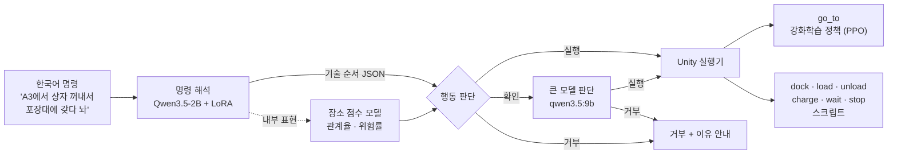
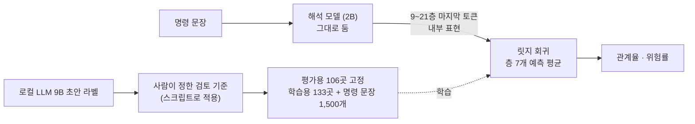
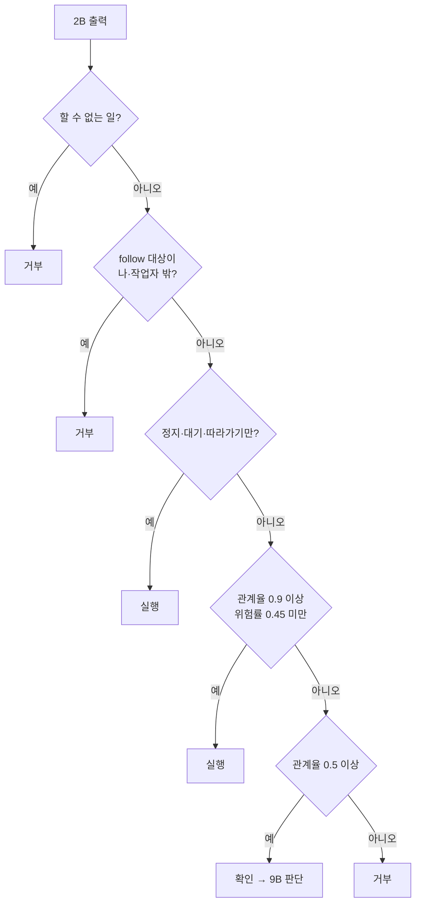
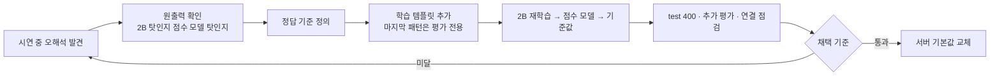
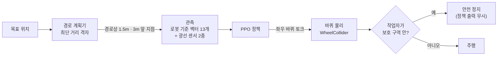
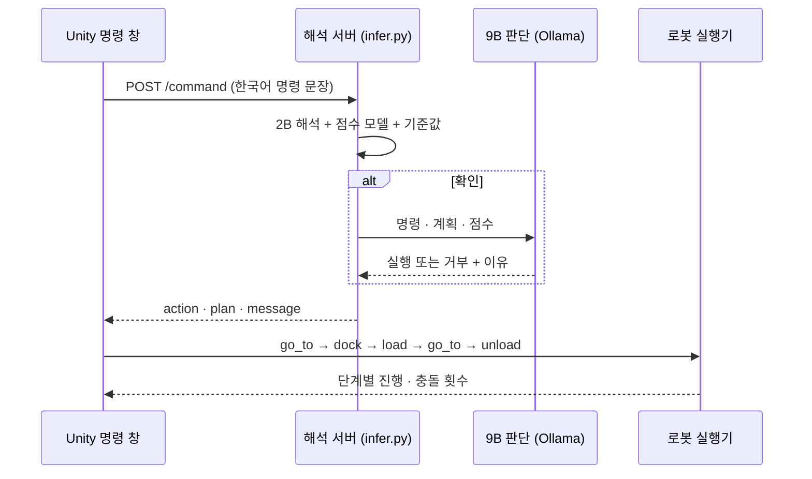

# warehouse-robot-llm

**한국어 명령 → 소형 LLM 이 기술 순서로 해석 → 강화학습 정책이 로봇 실행**

- 실내 창고의 바퀴형 운반 로봇이 한국어 자연어 명령을 받아 스스로 움직이는 시스템
- 소형 LLM 파인튜닝(명령 해석) + 안전 판단(장소 점수 모델·큰 모델 판단) + 강화학습 주행(Unity ML-Agents)을 하나의 흐름으로 연결
- 최종 목표: 같은 계층 구조(LLM 이 무엇을 → 계획기가 어디로 → 강화학습이 어떻게)를 휴머노이드에 적용


## 한눈에 보기

| 항목 | 결과 |
|---|---|
| 명령 해석 정확도 (test 400, 절반은 학습 때 못 본 표현) | 파인튜닝 전 **0%** → **99.5%** (Qwen3.5-2B + LoRA, 파인튜닝 전은 0.8B·50문장 기준) |
| 처음 보는 표현 정확도 | 73.0% → **95.5%** (모델·데이터 수는 그대로, 문장 표현 다양화만으로) |
| 목록 밖 장소로 잘못 실행 (처음 보는 장소 848문장) | 해석 모델만 123문장 → 점수 모델 적용 **2문장** (위험한 곳 28 → **0**) |
| 할 수 없는 일 거부 (추가 평가 세트) | 28.8% → **98.8%** (시연에서 찾은 문제를 데이터로 보강, 단계마다 평가 세트를 넓혀 측정 — 3장) |
| 강화학습 주행 (작업자 4명이 걷는 창고) | 도착률 **98.9%**, 고전 방식(NavMesh + Pure Pursuit + PID)보다 약 **15% 빠름** |

## 전체 구조



- **명령 해석**: 한국어 명령을 `{"plan": [{"skill": "go_to", "target": "A3"}, ...]}` 형태의 기술 순서로 변환
- **행동 판단**: 해석 모델이 목록 밖 장소를 비슷한 공식 위치로 끼워 맞추는 문제를 점수 모델로 걸러냄 → 실행 / 확인 / 거부
- **확인 처리**: 현장에서 사람이 매번 답할 수 없다는 가정 → 확인 대상은 큰 로컬 모델(9B)이 실행·거부 판단
- **실행**: 이동(`go_to`)은 바퀴 토크를 직접 내는 강화학습 정책, 싣기·내리기 등은 스크립트

## 1. 명령 해석: 소형 LLM 파인튜닝

### 명령 체계 ([llm/schema.py](llm/schema.py))

| 구분 | 내용 |
|---|---|
| 위치 | 선반 A1~D4 (16칸), `inbound` 입고장, `outbound` 출고장, `packing` 포장대, `charger` 충전소 |
| 물건 | `box` 상자, `parcel` 택배, `tote` 바구니 |
| 강화학습 기술 | `go_to(target)`, `dock(target)`, `follow(me \| worker)` |
| 스크립트 기술 | `load(item)`, `unload`, `charge`, `wait(sec)`, `stop` |
| 거부 | 없는 위치 `unknown_location`, 할 수 없는 일 `unsupported_command` → 엉뚱하게 움직이지 않게 하는 안전 장치 |

- 로봇 팔 대신 선반에 정확히 붙으면(`dock`) 싣기·내리기를 자동 처리하는 것으로 단순화

### 데이터 설계 ([make_data.py](llm/make_data.py))

- 템플릿으로 한국어 명령·정답 JSON 쌍 자동 생성 (train 4,000 / val 300 / test 400, 시드 고정)
- 한 작업, 두 작업 연결, 거부(없는 위치·할 수 없는 일) 포함
- 조사 `(으)로`·`을/를`·`이/가` 는 끝 글자 받침에 맞춰 선택 (숫자는 읽는 소리 기준: 1·7·8 → '로')
- **처음 보는 표현 평가**: 템플릿마다 마지막 문장 패턴과 연결 표현 하나는 test 전용 → test 400개 중 200개가 학습 때 못 본 표현
  - 외운 문장이 아닌 일반화 능력을 측정하려는 장치

### 학습 ([train.py](llm/train.py))

- Unsloth + LoRA (r 16, alpha 16, q/k/v/o/gate/up/down), bf16, 2 epoch (500 스텝, 2B 약 9분)
- transformers `Trainer` + 프롬프트 부분 labels 를 -100 으로 가려 **답변 JSON 만 학습**
  - TRL `SFTTrainer` 는 Qwen3.5 를 비전 모델로 보고 답변만 학습하는 옵션을 막는 사례가 있어 사용 안 함

### 결과 (test 400, greedy 생성, plan·error 완전 일치 기준)

| 모델 · 데이터 | 전체 | 본 패턴 | 처음 보는 패턴 | 거부 정확도 |
|---|---|---|---|---|
| Qwen3.5-0.8B 파인튜닝 전 (50개) | 0% | - | - | 0/3 |
| 0.8B · 데이터 v1 | 86.5% | 100% | 73.0% | 87.1% |
| 0.8B · 데이터 v2 (문장 표현 다양화) | 97.8% | 100% | 95.5% | 100% |
| 2B · 데이터 v2 | 99.0% | 99.5% | 98.5% | 93.5% |
| **2B · 데이터 v2 · strict 프롬프트** | **99.5%** | **100%** | **99.0%** | **100%** |

- 같은 모델·같은 데이터 수·같은 설정에서 **문장 표현만 늘려** 처음 보는 패턴 73.0% → 95.5%
  - 소형 모델에서는 데이터 표현 다양성이 일반화에 가장 크게 작용함
- 본 패턴만 봤다면 100% 로 보였을 약점("A에서 B까지 운반해"의 출발·도착을 뒤집음)을 처음 보는 패턴 평가가 드러냄

## 2. 안전 판단: 목록 밖 장소 과잉 해석 막기

### 문제

- test 의 거부 문장은 대부분 'G3' 같은 코드형이라 거부율이 높게 보였음
- '하역장·경비실·후문'처럼 **있을 법한 장소**로 점검 세트(64개)를 만들자 절반가량을 비슷한 공식 위치로 바꿔 실행 (하역장 → 입고장 등)
  - 0.8B 54.7%, 2B 51.6% 만 거부, strict 프롬프트로 학습해도 75.0%
- 단, '하역장 → 입고장'은 사용자 의도에 맞을 수도 있음 → 전부 거부가 정답이라고 보기 어려움

### 해결: 장소 점수 두 개로 행동 결정

- **창고 업무 관계율** (0~1): 그 장소가 창고 물류 작업과 얼마나 관련 있는가
- **위험률** (0~1): 로봇이 그 장소로 잘못 갔을 때의 피해 크기



- 해석 모델을 다시 학습하지 않고 **내부 표현 위에 작은 회귀층만 학습** → 숫자를 텍스트로 생성하게 하는 방식보다 정밀
- 라벨: 9B 초안에도 같은 과잉 해석(목록 밖 물류 장소에 관계율 1.0)이 있어 검토 기준을 스크립트(`fix_labels*.py`)로 남겨 재현 가능하게 함
- 평가는 **장소 단위 중첩 교차검증** (시험 장소의 문장은 학습·설정 선택에 쓰지 않음)
  - 평가 106곳 MAE 관계율 0.091 · 위험률 0.094, 장소 단위 행동 일치 95.3%
- 층 하나를 고르는 대신 9~21층 7개 예측을 평균 → 분할에 따라 행동이 바뀌는 장소 15곳 → 4곳 (실제 명령 형태의 학습 문장을 더한 뒤 0곳)

### 행동 규칙 ([e2e_check.py](llm/e2e_check.py) `final_action`)



- 기준값은 학습용 데이터로만 결정 (평가·test 는 확인에만 사용)
  - 관계율 기준: 라벨 구간의 의미 그대로 (0.9 이상 = 공식 위치)
  - 위험률 상한: 공식 위치 명령의 95% 가 통과하는 값 → 걸러내기는 관계율이 맡게 함

### 결과 (해석 + 점수 모델 연결 점검)

| | 해석 모델만 | 해석 + 점수 모델 |
|---|---|---|
| 처음 보는 장소 848문장 중 잘못 실행 (위험률 0.5 이상) | 123 (28) | **2 (0)** |
| test 정상 명령 바르게 실행 | 367/369 | 309/369 |
| test 없는 위치 명령 실행 / 할 수 없는 일 거부 | 0/19 · 12/12 | 0/19 · 12/12 |

- 잘못 실행 123 → 2문장, 위험한 곳은 0
- 대가: 정상 명령 일부를 바로 실행하지 않고 '확인'으로 보냄 (거부로 막힌 정상 명령은 0)

### 확인 처리: 큰 모델 판단 ([judge.py](llm/judge.py))

- '확인'이 나오면 사람에게 묻지 않고 로컬 `qwen3.5:9b` (Ollama)가 명령·계획·점수를 보고 실행·거부 결정
- 실행할 계획이 없으면 9B 를 부르지 않고 바로 거부
- 9B 는 계속 올려 두고 컨텍스트 4096 으로 제한 → 메모리 1.1GB 절약, 2B 응답(약 0.9초)에 영향 없음 확인
- 사고(thinking) 모드 시험: 응답 약 55초로 실시간 명령에 부적합 → 폐기

## 3. 시연에서 찾은 문제를 데이터로 고치기



| 버전 | 바꾼 것 (계기가 된 시연 문장) | 핵심 결과 (같은 평가 세트끼리 비교) | 판단 |
|---|---|---|---|
| v3 | 할 수 없는 일 3유형: 물건 아닌 대상 운반·사건 대기·경쟁 ('충전기가져와' → 충전하러 감) | 할 수 없는 일 거부 28.8% → 88.8% | 채택 |
| v4 | 꾸밈말 이동 + 인식 조건 ('관리인이 있는 A3으로 가' 를 거부함) | 거부 89.1% → 98.8%, 꾸밈말 이동 해석 0 → 34/40 | **채택 (현재 서버)** |
| v5 | 사람 위치 알림 → `go_to → dock` ('관리자가 A2에서 기다립니다 가세요') | 위치 알림 해석 0 → 40/40, 대신 처음 보는 할 수 없는 일 누락 증가 (164 → 158/165) | 미채택 |
| v6 | 위치 알림과 할 수 없는 일 대조 데이터 | 거부 157/165, 위험한 곳 잘못 실행 1 | 미채택 (기준 미달) |

- 채택 기준: 할 수 없는 일 거부가 기존 수준 이상 + 목록 밖 장소 중 위험한 곳 잘못 실행 0
- test 400 정확도는 모든 버전 99.2~99.5% 유지 → 기존 능력은 지키면서 새 유형만 보강
- 배운 점
  - 한 유형의 데이터를 넣으면 **구조가 비슷한 다른 유형으로 번짐** (사건 대기 데이터 → '사람이 나오면 거부'로 과일반화, 위치 알림 데이터 → 인식 조건 문장까지 실행 계획으로 해석)
  - 평가 전용 패턴과 수치 채택 기준을 미리 정해 두어야 개선처럼 보이는 퇴행을 걸러낼 수 있음

## 4. 주행: 강화학습 (Unity ML-Agents)


### 구조: 경로 계획 + 강화학습 제어



- 실제 창고 로봇의 나눔(위치 파악 + 경로 계획 + 현장 제어)과 같은 구조
  - 강화학습만으로 경로까지 찾게 하면 고정 맵에서는 A*·NavMesh 보다 불리하고 업계 구조와도 다름
  - 강화학습은 저수준 제어·움직이는 장애물 대응처럼 강한 부분을 맡음
- **바퀴 토크 직접 제어** (좌우 토크 연속 행동 2개): 속도 제어보다 어렵지만 실제 로봇에 가깝고, 토크로 움직이는 휴머노이드로 이어짐
- 창고 안 절대 위치는 관측에 넣지 않음 → 지도를 외우지 않고 경로 따라가기를 배우게 함

| 보상 항목 | 값 |
|---|---|
| 최단 경로를 따라 가까워짐 | 1m 당 +0.05 (멀어지면 −) |
| 도착 (0.5m 이내) | +1, 종료 |
| 충돌 · 뒤집힘 | −1, 종료 |
| 시간 | 에피소드 전체 −0.5 |
| 급조작 벌점 | 행동 변화량² × 0.005 |
| 후진 벌점 | 후진 1m 당 −0.08 |

### 결과 (결정적 추론, 수천~1만여 에피소드)

| 환경 | 방식 | 도착률 | 충돌률 | 도착까지 평균 |
|---|---|---|---|---|
| 정적 창고 | **강화학습** | 99.55% | 0.45% | **9.3초** |
| 정적 창고 | 고전 (NavMesh + Pure Pursuit + PID) | 99.72% | 0.28% | 11.3초 |
| 작업자 4명 + 안전 정지 | **강화학습** | 98.90% | 0.69% | **10.4초** |
| 작업자 4명 + 안전 정지 | 고전 + 안전 정지 | 99.32% | 0.35% | 12.2초 |

- 강화학습: 약 15~18% 빠르고 안전 정지 시간 비율도 약 25% 적음 (5.7% vs 7.6%, 사람 앞으로 덜 들어감)
- 고전 방식: 충돌이 더 적음 → 속도와 충돌의 맞교환 관계를 수치로 확인
  - 고전 방식도 따라갈 점을 멀리 두고 회전 기준을 넓히면 빨라지지만 선반 모서리를 질러가며 충돌 급증 (0.36% → 40%)
- 학습: 학습장 25개 병렬, 500만 스텝 약 34분, 100만~160만 스텝 무렵 도착률 98% 이상으로 수렴

### 시행착오

- **후진 주행을 배움**: 몸체가 앞뒤 대칭이고 광선 센서가 360° 라 후진으로 주행
  - 후진 속도 제한(0.5 m/s) 후 이어서 학습 → 습관이 남아 2배 느려짐 → 처음부터 재학습 + 후진 벌점으로 전진 주행 학습
- **시작 직후 충돌 58%**: 시작 위치 검사를 격자로만 해서 회전한 몸체 모서리가 장애물과 겹침 → 실제 몸체 크기로 검사, 충돌률 1.29% → 0.71%
- **사람과 교착**: 로봇·작업자가 서로 멈춰 시간 초과 19.5% → 현장 방식대로 '로봇은 멈추고 사람이 돌아감' + 갇힌 작업자 목적지 변경 → 시간 초과 0.3~0.4%
- **가까운 장애물 인식**: 8m 광선만으로는 근거리 해상도 부족 → 2m 근거리 광선(25개) 추가, 충돌률 1.59% → 0.69% (작업자 갇힘 수정과 함께 적용해 효과를 따로 나누지는 못함)

## 5. 연결 시연



| 명령 | 판단 | 응답 시간 | 결과 |
|---|---|---|---|
| A3에서 상자 꺼내서 포장대에 갖다 놔 | 실행 (5단계 계획) | 3.8초 | 끝까지 실행 |
| 하역장으로 가 | 확인 ("입고장으로 보면 될까요?") | 1.0초 | 목록 밖 장소라 판단 보류 |
| 주차장으로 가 | 거부 (관계율 0.13 · 위험률 0.76) | 0.7초 | 실행 안 함 |

- 한국어 명령 → LLM → Unity 로봇까지 실행·확인·거부 세 경로 모두 연결
- 시연 외형: Blender 로 로봇·선반·작업대·창고·작업자 모델 제작, **콜라이더·위치·태그는 그대로** 두어 학습된 정책 입력이 바뀌지 않게 함

## 기술 스택

| 영역 | 사용 |
|---|---|
| LLM | Qwen3.5-2B / 0.8B, Unsloth (LoRA), transformers, PyTorch |
| 안전 판단 | 내부 표현 + 릿지 회귀 (직접 구현), Ollama `qwen3.5:9b` (라벨 초안·확인 판단) |
| 강화학습 | Unity 6 (URP), ML-Agents 4.0.3 / mlagents 1.1.0 (PPO), AI Navigation (NavMesh 비교 기준) |
| 연결 | Python HTTP 서버 ↔ Unity `UnityWebRequest` |
| 외형 | Blender (FBX) |

## 저장소 구조

```
warehouse-robot-llm/
├─ llm/
│  ├─ schema.py                    명령 체계·시스템 프롬프트 (기준 파일)
│  ├─ make_data.py                 학습·평가 데이터 생성
│  ├─ train.py / evaluate.py       LoRA 파인튜닝 / test 400 평가
│  ├─ label_with_llm.py, fix_labels*.py              장소 점수 라벨 (9B 초안 → 검토 기준)
│  ├─ make_scorer_sentences.py, train_scorer.py, tune_thresholds.py   점수 모델·기준값
│  ├─ e2e_check.py                 해석 + 점수 모델 연결 점검
│  ├─ make_probe_unsupported.py, probe_check.py      할 수 없는 일·꾸밈말 추가 평가
│  ├─ judge.py                     확인 → 9B 판단
│  ├─ infer.py                     최종 진입점 (CLI · HTTP 서버)
│  ├─ data/  results/              데이터·라벨 / 평가 결과 (문장별 예측 포함)
├─ unity/WarehouseRobot/Assets/01Script/
│  ├─ Robot/RobotAgent.cs          강화학습 에이전트 (관측·보상·안전 정지)
│  ├─ Robot/ClassicController.cs   비교 기준 (NavMesh + Pure Pursuit + PID)
│  ├─ Warehouse/WarehouseArea.cs   창고 배치·최단 거리 격자·시작 위치
│  ├─ Warehouse/WorkerWalker.cs    걷는 작업자
│  └─ Demo/DemoCommandConsole.cs   명령 창·기술 실행 (LLM 서버 연결)
├─ rl/configs/  rl/eval/           ML-Agents 학습 설정 / 평가 기록
└─ docs/images/                    README 이미지
```

## 실행 방법

- LLM (`llm/` 폴더): Python 3.12, PyTorch (CUDA), Unsloth, transformers
  ```bash
  python make_data.py                 # 학습 데이터 (test.jsonl 은 고정)
  python train.py --model unsloth/Qwen3.5-2B --out outputs/qwen35_2b_v4_strict --prompt strict
  python evaluate.py --model outputs/qwen35_2b_v4_strict/merged --prompt strict --name ft_v4
  python infer.py --serve --port 8765 # 해석 서버 (9B 판단은 Ollama 필요, 없으면 --no_judge)
  ```
- 강화학습: Python 3.10 + mlagents 1.1.0, Unity 6000.3 + ML-Agents 4.0.3
  ```bash
  mlagents-learn rl/configs/goto.yaml --run-id goto --results-dir rl/results   # 이후 Unity Play
  ```
- 시연: 해석 서버 실행 → Unity `Assets/00Scene/Demo.unity` Play → 명령 창에 입력
- 모델 가중치는 용량 때문에 저장소에 없음 → 위 명령으로 다시 생성

## 한계와 다음 단계

- `dock` 은 임시 스크립트, `follow` 는 아직 학습 전
- 사람 위치 알림(`go_to → dock`)과 인식 조건 거부를 동시에 만족하는 데이터 미완 (v5·v6 미채택)
- 해석 모델 단독으로는 물류 경계 장소(입고 대기 구역 등)를 공식 위치로 해석 → 점수 모델·9B 판단에 의존
- 정상 명령 일부를 '확인'으로 보내는 비용 (특히 충전소 계열·두 작업 연결)
- 다음: 휴머노이드 — LLM 이 무엇을, 계획기가 어디로, 강화학습이 어떻게 걸을지로 같은 계층 구조 적용
